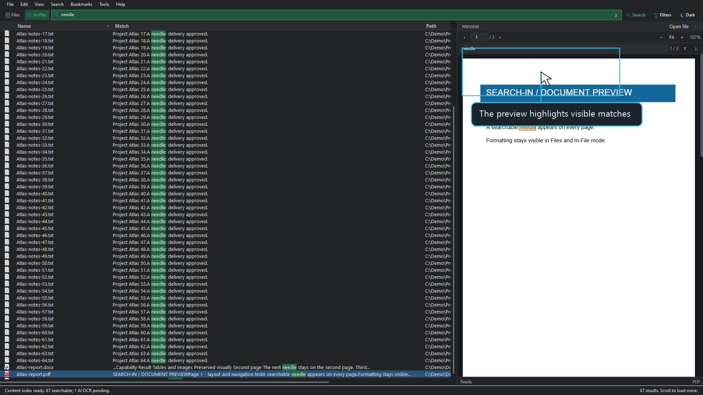

<div align="center">


# SEARCH-IN

### Fast Windows file search, local content discovery, and optional AI OCR

**Formerly LOCALOCR. The same project, a new name, and a new preview experience.**

[](https://github.com/promptedteam/searchin/releases/latest)
[](https://github.com/promptedteam/searchin/releases)


[Download Setup](https://github.com/promptedteam/searchin/releases/download/2.1.0.104/SEARCH-IN-2.1.0.104-Setup.exe) &middot; [Download Portable](https://github.com/promptedteam/searchin/releases/download/2.1.0.104/SEARCH-IN-2.1.0.104-portable.zip) &middot; [Release notes](https://github.com/promptedteam/searchin/releases/tag/2.1.0.104)

[Explore SEARCH-IN](https://searchin.pages.dev/) &middot; [Watch tutorials](https://searchin.pages.dev/#guides) &middot; [Roadmap](https://searchin.pages.dev/#roadmap)

<a href="https://github.com/promptedteam/searchin/stargazers"></a>

</div>



## Find Files And What Is Inside Them

Search filenames across the native local catalog, or switch to **In-File** to search indexed document text. Select a result to read it in the embedded viewer without opening another application.

| Feature | What you can do |
| --- | --- |
| **Files** | Find names and paths with a native NTFS/MFT catalog and live filesystem updates. |
| **In-File** | Search locally extracted text and read highlighted Match snippets. |
| **Preview** | Navigate PDF pages, find text, view formatted Word/RTF, inspect images, and use the bundled format viewers. |
| **Content Indexer** | Choose a folder, start or resume local extraction, and monitor progress in a compact tray tool. |
| **Optional AI OCR** | Process eligible unreadable files only after local indexing and your confirmation. |
| **Multiple API keys** | Save encrypted key collections per provider; rotate on rate limits and wait/resume when all enabled keys are cooling down. |
| **Large result sets** | Scroll through paged results with bounded rendering rather than loading millions of visual rows. |
| **Your theme** | Follow Windows automatically, or select Light or Dark manually. |
| **Quiet updates** | A download indicator announces updates. Open it to download, verify SHA-256, and choose when to run Setup. |

SEARCH-IN is independent software. It does not require Everything, EverythingToolbar, or QuickLook to be installed.

## Four One-Minute Guides

**Play the videos directly below, inside GitHub.** Use each player's full-screen button for the clearest application text. No download is needed. The [SEARCH-IN website](https://searchin.pages.dev/#guides) brings tutorials, timestamped steps, features, downloads, and the roadmap together on one page. Its videos stay in a two-column grid on desktop and mobile.

<table>
<tr>
<td width="50%" valign="top">

### 01 Install SEARCH-IN

https://github.com/user-attachments/assets/4c880fe3-86d7-4cd4-8ea7-b12027ea57e5

**1 minute.** .NET Desktop Runtime, WebView2, and Setup. Clearly labeled installation walkthrough; the real GitHub download segment is being prepared separately.

</td>
<td width="50%" valign="top">

### 02 Index And Optional AI

https://github.com/user-attachments/assets/6e58c0e2-fc1a-4a80-909a-9b4769492583

**1 minute.** Choose the index scope, extract locally first, check AI Pending, and save provider settings. No real API request is made in the demo.

</td>
</tr>
<tr>
<td width="50%" valign="top">

### 03 Find Files And Folders

https://github.com/user-attachments/assets/ca18b79b-76c6-4544-8035-481268b1aa6f

**1 minute.** Search names and extensions, use filters, select a directory, match paths, and preview a result.

</td>
<td width="50%" valign="top">

### 04 Search Inside Files

https://github.com/user-attachments/assets/c853e2c5-34a2-4b01-87be-6b5aca621686

**1 minute.** Search indexed text, read Match snippets, navigate highlighted PDF matches, and preview text.

</td>
</tr>
</table>

The app demonstrations use synthetic files and fictional `C:\Demo` paths. No personal desktop, documents, or working API credentials are shown. Recordings are native 1920 x 1080 at 30 fps, with scripted pointers and on-screen guidance.

## Get SEARCH-IN

**New in 2.1.0.104:** corrected result-column sorting, accurate Path/Ext/Modified ordering, and faster sort-direction changes. [See what changed](docs/RELEASE-2.1.0.104.md).

| Package | Best for |
| --- | --- |
| [**Setup**](https://github.com/promptedteam/searchin/releases/download/2.1.0.104/SEARCH-IN-2.1.0.104-Setup.exe) | Recommended. Installs SEARCH-IN and its engine service, adds shortcuts, and supports future SEARCH-IN updates. |
| [**Portable ZIP**](https://github.com/promptedteam/searchin/releases/download/2.1.0.104/SEARCH-IN-2.1.0.104-portable.zip) | Extract the complete ZIP before running `SearchIn.exe`. `Preview-Samples.cmd` opens synthetic samples without a PC-wide index. |

**Requirements:** Windows 10 or 11, x64; Microsoft .NET 10 Desktop Runtime (x64); Microsoft Edge WebView2 Runtime. Setup checks the prerequisites and can obtain missing components from Microsoft with internet access. The engine does not require a separate Visual C++ redistributable.

**Offline PC:** obtain the official standalone .NET Desktop Runtime and WebView2 Evergreen installers on another PC first. The small WebView2 bootstrapper needs internet and is not the offline runtime.

**First run:** allow the engine to build its filename catalog. For document-text search, open **Tools > Open Content Indexer**, choose a scope, and press **Start**. AI OCR is optional and is not needed for documents whose text can be read locally.

### Updating From Earlier Builds

Install `2.1.0.104` once if you used an earlier local SEARCH-IN test build: those builds deliberately disabled online update checks. Future published SEARCH-IN updates use the in-app downloader. Existing SEARCH-IN configuration, encrypted keys, bookmarks, and indexes remain in their existing locations.

Already on `2.1.0.103`? Reopen SEARCH-IN and use the quiet **New update** indicator. To test this exact update path from an older local build, install [2.1.0.103](https://github.com/promptedteam/searchin/releases/download/2.1.0.103/SEARCH-IN-2.1.0.103-Setup.exe) once, then let it detect `2.1.0.104`.

LOCALOCR 1.x remains a separate installation. This release does not silently convert or delete its databases or credentials. Its old update feed remains valid. The repository is now `promptedteam/searchin`; GitHub redirects the former `promptedteam/LOCALOCR` repository links. Releases, stars, and inline videos are retained.

## Preview Coverage

| Category | Included viewers |
| --- | --- |
| **Documents** | PDF; Word DOCX/DOCM/DOTX/DOTM; formatted RTF; basic XLSX/XLSM worksheet values and PPTX/PPTM slide text. |
| **Images and design** | JPEG, PNG, GIF/APNG, WebP, AVIF, BMP, ICO, SVG; supported PSD composites and PDF-compatible Illustrator files. |
| **Text and developer files** | Text, syntax-highlighted code/configuration, sanitized Markdown, subtitles, archives, and a read-only binary hex view. |
| **Media and specialist formats** | Supported video/audio codecs, CBZ/CBR comics, EPUB chapters, OBJ/STL/FBX geometry, MusicXML/MXL, and font specimens. |

Word layout is approximate; advanced Office features, media codecs, and specialist formats have limits. RAW/HEIC/TIFF, EPS, MOBI/AZW, and legacy Office renderers are not bundled. See the [complete format matrix and limits](docs/PREVIEW-FORMATS.md) rather than assuming every QuickLook plugin is included.

## Privacy And Verification

Local indexing and previews stay on the computer. Optional AI OCR sends files only after you choose a provider and confirm a run. API credentials are protected for the current Windows account, stored outside the installation folder, and excluded from releases. See [AI OCR](docs/AI-OCR.md), [Privacy](PRIVACY.md), and [Security](SECURITY.md).

Compare downloaded files with [SHA256SUMS.txt](https://github.com/promptedteam/searchin/releases/download/2.1.0.104/SHA256SUMS.txt):

The application packages are not currently code-signed. Windows may show a publisher or SmartScreen warning; verify the release source and checksum before installing.

```powershell
Get-FileHash .\SEARCH-IN-2.1.0.104-Setup.exe -Algorithm SHA256
```

## Distribution And Source

This public repository contains downloads, documentation, approved demo media, and update metadata only. **Application source code remains private and is not uploaded here.** Release binaries are attached to GitHub Releases, not committed to the main branch. No credential files, local databases, user settings, or private captures belong in this repository.

The release/download/star badges refresh through their badge service. No star-counter bot rewrites the README or updater manifests.

Version numbers use `MAJOR.MINOR.FEATURE.PATCH`; `2.1.0.104` is the current public SEARCH-IN build.

---

<div align="center"><strong>SEARCH-IN 2.1.0.104</strong><br>Formerly LOCALOCR &middot; By promptedteam</div>
