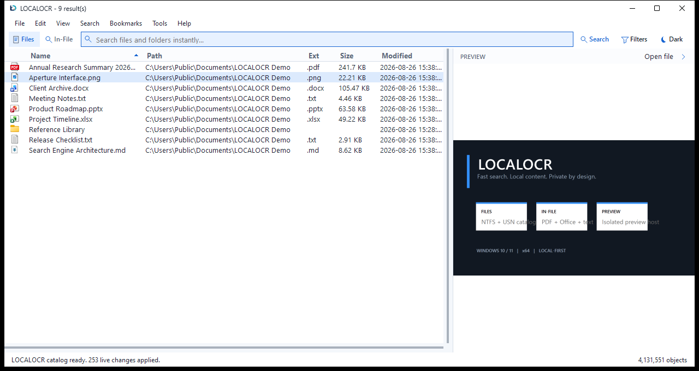

<div align="center">

# LOCALOCR

### Fast Windows file search, local content discovery, and optional AI OCR

[](https://github.com/promptedteam/LOCALOCR/releases/latest)
[](https://github.com/promptedteam/LOCALOCR/releases)


[Download Setup](https://github.com/promptedteam/LOCALOCR/releases/download/1.5.3.100/LOCALOCR-1.5.3.100-Setup.exe) · [Download Portable](https://github.com/promptedteam/LOCALOCR/releases/download/1.5.3.100/LOCALOCR-1.5.3.100-portable.zip) · [Release notes](https://github.com/promptedteam/LOCALOCR/releases/tag/1.5.3.100)

<a href="https://github.com/promptedteam/LOCALOCR/stargazers">
  
</a>

</div>

<picture>
  <source media="(prefers-color-scheme: dark)" srcset="docs/images/localocr-dark.png">
  <source media="(prefers-color-scheme: light)" srcset="docs/images/localocr-light.png">
  
</picture>

## Find locally

LOCALOCR combines fast filename search, manually scoped local content indexing, and file previews in one compact Windows desktop application. Local extraction stays on the computer. Optional AI OCR contacts a selected provider only after the user explicitly starts and confirms a bounded run.

| Capability | What it provides |
| --- | --- |
| **Files** | Fast filename and path search backed by a native NTFS/MFT catalog with live USN Journal updates. |
| **In-File** | Search text extracted from selected folders or, only when explicitly chosen, the entire PC. |
| **Optional AI OCR** | After local extraction, process only unreadable images and scanned PDFs through a configured API or installed AI CLI. |
| **Preview** | Images, PDF, Office documents, text, code, and compatible Windows preview handlers in a hidden isolated host. |
| **Focused scope** | Limit filename or content work to a directory while retaining the option to search the PC. |
| **Responsive results** | Bounded rendering, background engine work, sortable columns, quick filters, and highlighted matches. |
| **Automatic engine recovery** | Restarts the native search service after an unexpected stop and reconnects without losing the existing catalog. |
| **System, light, and dark** | Follows the Windows app theme by default while preserving explicit Light and Dark overrides. |
| **Verified updates** | Shows a quiet **New update** reminder, then downloads Setup inside LOCALOCR only after the user opens it and confirms. |
| **Companion access** | Provides a current-user-only, read-only search bridge for LOCALTOOL without installing another engine. |

LOCALOCR is independent software and does not require Everything or the Everything SDK.

## Get LOCALOCR

| Package | Best for | Download |
| --- | --- | --- |
| **Setup** | Recommended. Installs the application and LOCALOCR Engine service, creates shortcuts, and supports in-place updates. | [LOCALOCR-1.5.3.100-Setup.exe](https://github.com/promptedteam/LOCALOCR/releases/download/1.5.3.100/LOCALOCR-1.5.3.100-Setup.exe) |
| **Portable** | Testing without a normal application install. Extract the complete ZIP before opening `LOCALOCR.exe`. | [LOCALOCR-1.5.3.100-portable.zip](https://github.com/promptedteam/LOCALOCR/releases/download/1.5.3.100/LOCALOCR-1.5.3.100-portable.zip) |

**Requirements:** Windows 10 or Windows 11, x64. LOCALOCR uses Microsoft .NET 10 Desktop Runtime. Setup detects it and can download the official Microsoft installer when required. The native engine statically includes its MSVC runtime, so a separate Visual C++ redistributable is not required.

The Setup package requests administrator access to install the LOCALOCR Engine service. Portable mode can install that same service when requested or run an elevated temporary engine session.

## Verify the download

```text
D3D640ACC12DA5277A9DF9DC76AFED4407BEE8B494C33896EB79AD3278BDF058  LOCALOCR-1.5.3.100-Setup.exe
AF097DF4BD3AA1CCA875E05C169440E79C93E10FE9B10DB3C8DC0B65C8152ECB  LOCALOCR-1.5.3.100-portable.zip
```

The same values are included in `SHA256SUMS.txt` on the release page.

## Privacy boundary

Filename catalogs, locally extracted content, settings, and bookmarks stay on the local computer. LOCALOCR has no telemetry or analytics client. AI OCR is off by default; when explicitly started, the selected provider receives only the pending files in that confirmed run. See [AI OCR](docs/AI-OCR.md) and [PRIVACY.md](PRIVACY.md) for the complete boundary.

## Version numbers

LOCALOCR uses `MAJOR.MINOR.FEATURE.PATCH`:

| Change size | Example |
| --- | --- |
| Small correction | `1.5.2.100` → `1.5.2.101` |
| Feature update | `1.5.2.101` → `1.5.3.100` |
| Broad product update | `1.5.3.100` → `1.6.0.100` |
| Generational release | `1.x` → `2.0.0.0` |

## Distribution and source

This is the public **distribution repository**. It contains release information, screenshots, checksums, and update metadata. Release binaries are stored as GitHub Release assets rather than committed to the repository.

LOCALOCR source code is maintained privately and is not included in this public distribution repository. Publishing releases here does not publish or license the source code.

---

<div align="center">
  <strong>LOCALOCR 1.5.3.100</strong><br>
  Search fast. Search locally.
</div>
